  

  

---

### 🛠️ Skills and Tools

  

  
More about my BA skills & workflow

- **Modeling & Documentation:** Use Case, ERD, BPMN, Flowchart, SRS / BRD, User Journey (Draw.io, Figma, Google Docs, Excel)
- **Database Design:** 3NF Schema Design, Relational Mapping, SQL Queries (PostgreSQL, MySQL, SQL Server, Supabase)
- **Web Prototyping:** Translating system requirements into interactive UI prototypes (HTML, CSS, JavaScript, React, Next.js)

  <picture>
    <source media="(prefers-color-scheme: dark)" srcset="https://raw.githubusercontent.com/Kain-Nguyen/Kain-Nguyen/output/pacman-contribution-graph-dark.svg">
    <source media="(prefers-color-scheme: light)" srcset="https://raw.githubusercontent.com/Kain-Nguyen/Kain-Nguyen/output/pacman-contribution-graph.svg">
    
  </picture>

  

